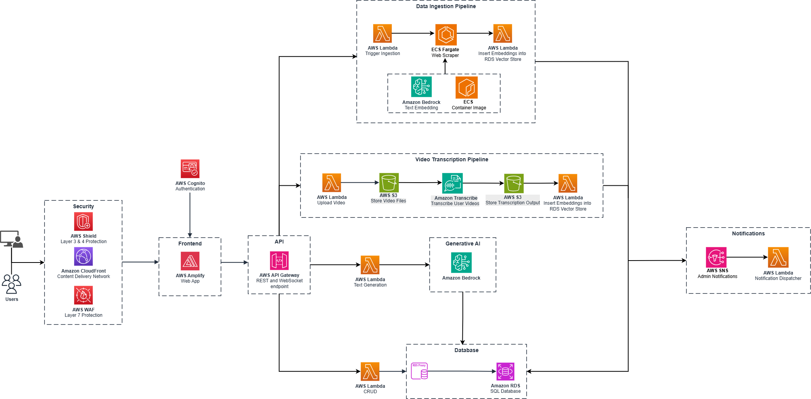
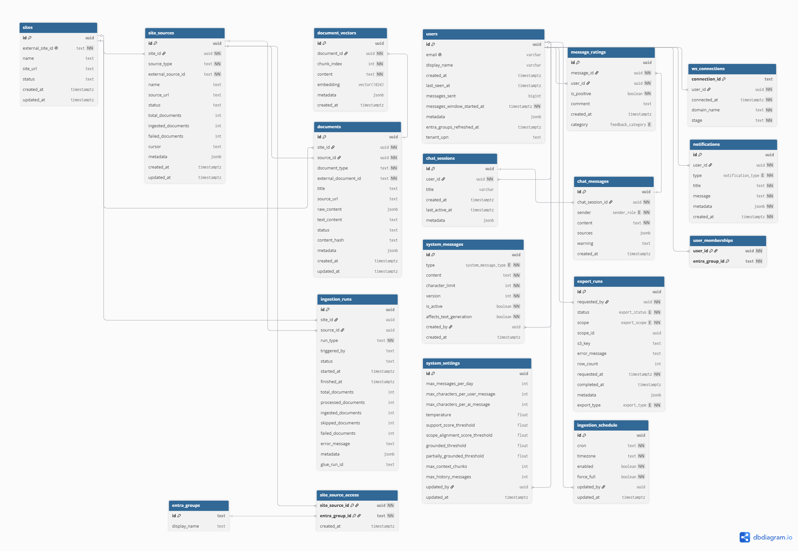

# Architecture Deep Dive

## Architecture

1. Users reach the React frontend hosted on AWS Amplify (served through Amazon CloudFront). The REST API sits behind AWS WAF; AWS Shield Standard covers both.

2. Administrators sign in with Amazon Cognito (TOTP MFA required); only members of the `admin` group reach the admin dashboard and admin APIs. Public users have no account: the browser creates an anonymous user (`POST /user`), keeps a 30-day credential, and exchanges it at `GET /user/publicToken` for 15-minute access tokens bound to that user.

3. The frontend calls the REST API (API Gateway → Lambda) for users, chat sessions, system messages and admin operations. Each route is protected by a Lambda authorizer: the user authorizer for public access tokens, the admin authorizer for Cognito ID tokens. Chat turns go over the WebSocket API: `$connect` verifies the access token and binds the connection to the user, and `$default` rate-limits each frame and invokes the text generation Lambda, which streams the reply back over the connection.

4. Lambda functions run in the VPC and reach Amazon RDS for PostgreSQL through RDS Proxy over TLS, using credentials from Secrets Manager that rotate automatically.

5. PostgreSQL holds everything the application stores: users, chat sessions and messages, prompts and settings, journeys, ingestion state, and the knowledge base itself (source text, chunks and their vector embeddings in **pgvector**).

6. For each chat turn the text generation Lambda:
   - checks the kill switch, service status and the per-user, per-day and service-wide limits;
   - screens the message with the **input guardrail** (Amazon Bedrock Guardrails);
   - runs a fast **router** call that rewrites the message into a retrieval query and decides the phase: ask a clarifying question (detective), give partial guidance, or give full guidance (suggestion);
   - for guidance turns, embeds the query with the active embedding model and searches pgvector for the most relevant chunks (and any journey guideline sections);
   - streams the answer from Claude Haiku 5.5 on Amazon Bedrock, with retrieved content marked as untrusted data;
   - screens the answer with the **output guardrail**, runs a **grounding check** against the cited sources for guidance turns, and saves the reply with its citations.

7. Administrators add content from the dashboard. Files (PDF, DOCX, TXT, CSV, Markdown) are uploaded to the S3 ingest bucket through presigned URLs and processed by the knowledge base Lambda (Amazon Textract reads PDFs, including scanned ones). Websites are crawled by a container on **Amazon ECS (Fargate)**. Uploaded video and audio files are transcribed by Amazon Transcribe and then chunked by a second container. Every path chunks the text, embeds it with Amazon Bedrock, and writes sources, chunks and vectors to PostgreSQL.

8. The embedding model is swappable. Vectors are stored per **embedding space** (model + dimension), so a new model can be built next to the live one, validated, and activated from the admin dashboard without downtime. New installs start on Amazon Titan Text Embeddings V2. See the [embedding model swap runbook](./runbooks/embedding-model-swap.md).

9. AWS CodePipeline runs the unit tests, then builds, scans and pushes the crawler and transcriber images to Amazon ECR. A weekly Lambda alerts when a Bedrock model the system depends on approaches end of life. CloudWatch alarms and cost alerts publish to an SNS topic.

For the full list of stacks see the [Deployment Guide](./DEPLOYMENT_GUIDE.md#stacks-deployed); for ingestion details see [Knowledge Base Documentation](./KNOWLEDGE_BASE_DOCUMENTATION.md); for security controls see [Security Overview](./SECURITY_OVERVIEW.md).

### Why pgvector?

The project originally used Amazon Bedrock Knowledge Bases with OpenSearch Serverless. It moved retrieval into the existing PostgreSQL database ([migration plan](./PGVECTOR_MIGRATION_PLAN.md), now historical) because:

- **Cost** — no OpenSearch Serverless capacity units; vector search runs on the RDS instance that already exists.
- **Control** — chunking, metadata, citations and filtering are application code, so CSV rows, linked pages, videos and guideline sections can each be chunked and cited the way they need.
- **One store** — sources, chunks, vectors and the rest of the application data live in one database, so deleting a data source removes its content from retrieval in the same transaction.
- **Swappable models** — embedding spaces let a model be replaced with a rebuild and cutover instead of a re-ingest.

## Database Schema

Migrations in `cdk/lambda/db_setup/migrations/` are the source of truth for the schema; see [Database Migrations](./DATABASE_MIGRATIONS.md). The tables below are grouped by purpose, with the migration that introduced each one.

> The database diagram below predates the pgvector migration and shows only the original tables.

### Users and chat

| Table | Purpose | Migration |
|---|---|---|
| `users` | Anonymous public users and administrators (`role`: `student` for public users, `admin`), credential version, identity source, normalized email | 000 |
| `chat_sessions` | One row per conversation: title, journey and routing state, guide state, and eval-harness columns | 000 |
| `chat_messages` | Messages (`sender`: `user` or `AI`) with their public citations and grounding warning | 000 |
| `session_feedback` | End-of-conversation thumbs up/down and optional comment, with admin triage fields | 021 |

### Knowledge base

| Table | Purpose | Migration |
|---|---|---|
| `data_sources` | What an administrator added (`type`: `website`, `csv`, `markdown`, `json`, `video`, `document`) | 000 |
| `ingestion_runs` | One row per ingestion attempt (`status`: `pending`, `queued`, `running`, `failed`, `completed`) with counters and errors | 000 |
| `sources` | One row per retrievable source (`source_type`: `web`, `video`, `document`, `csv_link`, `csv_row`) | 001 |
| `chunks` | Chunk text and metadata for each source | 001 |
| `csv_row_links` | CSV rows whose link column is fetched and embedded as its own source | 016 |
| `web_source_owners` | Which website data sources crawled each page, so deleting a website removes its pages | 038 |
| `upload_issuances` | Binds each presigned upload to the administrator it was issued to | 045 |

### Embeddings

| Table | Purpose | Migration |
|---|---|---|
| `embedding_spaces` | One row per embedding model + dimension, with lifecycle status and per-space retrieval settings | 032 |
| `embedding_active_space` | Single row naming the space retrieval reads and ingestion writes | 032 |
| `chunk_embeddings` | One vector per (chunk, space), searched through a per-space HNSW index | 032 |
| `embedding_jobs` | Long-running dry-run, rebuild, delta, validate, activate and rollback jobs | 033 |

### Prompts, journeys and guidelines

| Table | Purpose | Migration |
|---|---|---|
| `system_messages` | Versioned prompt blocks (role, guardrails, language guidelines, phase prompts, output formats, welcome message) | 000 |
| `system_settings` | Single row of admin settings: limits, routing mode, service status | 000 |
| `journeys`, `journey_clusters`, `journey_prompt_versions` | Admin-managed journeys and situation clusters used by the router and prompts | 024 |
| `guideline_config`, `guideline_documents`, `guideline_sections` | Uploaded guidance documents and their detected sections | 031 |

### Limits, audit and retention

| Table | Purpose | Migration |
|---|---|---|
| `user_daily_usage` | Per-user, per-UTC-day character and new-session counts | 034, 047 |
| `daily_usage_requests` | Makes daily-limit reservations idempotent per Lambda request | 034 |
| `global_daily_usage` | Service-wide message count per UTC day | 036 |
| `user_inflight_generations` | At most one in-flight generation per user | 037 |
| `admin_audit` | Who performed each privileged admin action | 040 |
| `analytics_archive` | Anonymous daily counts kept after inactive guests are deleted (90 days idle) | 048 |

No table stores message text outside `chat_messages`; the limit, audit and archive tables hold only counts, ids and field names.
