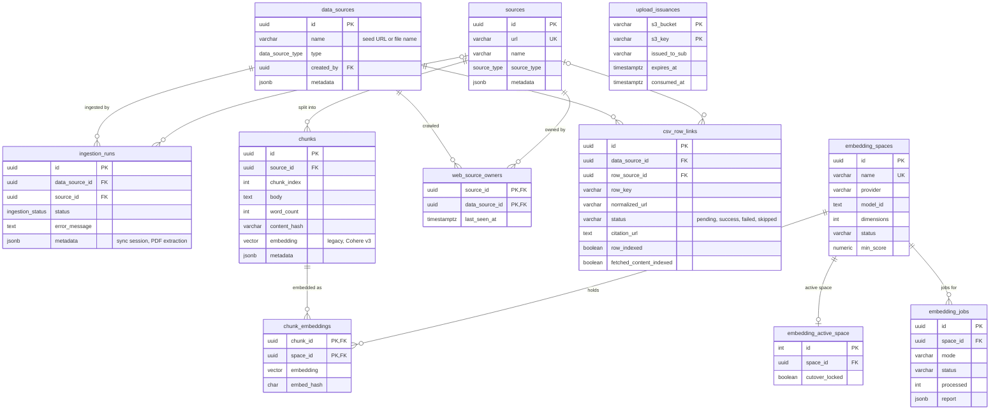

# Architecture Deep Dive

## Architecture

1. Users reach the React frontend hosted on AWS Amplify (served through Amazon CloudFront). The REST API sits behind AWS WAF; AWS Shield Standard covers both.

2. Administrators sign in with Amazon Cognito; only members of the `admin` group reach the admin dashboard and admin APIs. Public users have no account: the browser creates an anonymous user (`POST /user`), keeps a 30-day credential, and exchanges it at `GET /user/publicToken` for 15-minute access tokens bound to that user.

3. The frontend calls the REST API (API Gateway → Lambda) for users, chat sessions, system messages and admin operations. Each route is protected by a Lambda authorizer: the user authorizer for public access tokens, the admin authorizer for Cognito ID tokens. Chat turns go over the WebSocket API: `$connect` verifies the access token and binds the connection to the user, and `$default` rate-limits each frame and invokes the text generation Lambda, which streams the reply back over the connection.

4. Lambda functions run in the VPC and reach Amazon RDS for PostgreSQL through RDS Proxy over TLS, using credentials from Secrets Manager that rotate automatically.

5. PostgreSQL holds everything the application stores: users, chat sessions and messages, prompts and settings, journeys, ingestion state, and the knowledge base itself (source text, chunks and their vector embeddings in **pgvector**).

6. For each chat turn the text generation Lambda:
   - checks the kill switch, service status and the per-user, per-day and service-wide limits;
   - screens the message with the **input guardrail** (Amazon Bedrock Guardrails);
   - runs a fast **router** call that rewrites the message into a retrieval query and decides the phase: ask a clarifying question (detective), give partial guidance, or give full guidance (suggestion);
   - for guidance turns, embeds the query with the active embedding model and searches pgvector for the most relevant chunks (and any journey guideline sections);
   - streams the answer from Claude Haiku 5.5 on Amazon Bedrock, with retrieved content marked as untrusted data;
   - screens the answer with the **output guardrail**, runs a **grounding check** against the cited sources for guidance turns, and saves the reply with its citations.

7. Administrators add content from the dashboard. Files (PDF, DOCX, TXT, CSV, Markdown) are uploaded to the S3 ingest bucket through presigned URLs and processed by the knowledge base Lambda (Amazon Textract reads PDFs, including scanned ones). Websites are crawled by a container on **Amazon ECS (Fargate)**. Uploaded video and audio files are transcribed by Amazon Transcribe and then chunked by a second container. Every path chunks the text, embeds it with Amazon Bedrock, and writes sources, chunks and vectors to PostgreSQL.

8. The embedding model is swappable. Vectors are stored per **embedding space** (model + dimension), so a new model can be built next to the live one, validated, and activated from the admin dashboard without downtime. New installs start on Amazon Titan Text Embeddings V2. See [Embedding Spaces](./KNOWLEDGE_BASE_DOCUMENTATION.md#embedding-spaces).

9. AWS CodePipeline runs the unit tests, then builds, scans and pushes the crawler and transcriber images to Amazon ECR. A weekly Lambda alerts when a Bedrock model the system depends on approaches end of life. CloudWatch alarms and cost alerts publish to an SNS topic.

For the full list of stacks see the [Deployment Guide](./DEPLOYMENT_GUIDE.md#stacks-deployed); for ingestion details see [Knowledge Base Documentation](./KNOWLEDGE_BASE_DOCUMENTATION.md); for security controls see [Security Overview](./SECURITY_OVERVIEW.md).

## Database Schema

Migrations in `cdk/lambda/db_setup/migrations/` are the source of truth for the schema; see [Database Migrations](./DATABASE_MIGRATIONS.md). The tables below are grouped by purpose, with the migration that introduced each one.

The diagrams show each table's keys and main columns as of migration 050 (which adds a unique index allowing one active row per `type` in `system_messages` and changes no columns). Tables without lines have no foreign keys. The `created_by` and `updated_by` columns that point at an administrator's `users` row (on `data_sources`, `system_messages`, `system_settings`, `journeys`, `journey_clusters` and `journey_prompt_versions`) are not drawn.

### Users, chat, prompts and limits

```mermaid
erDiagram
    users ||--o{ chat_sessions : owns
    chat_sessions ||--o{ chat_messages : contains
    chat_sessions ||--o| session_feedback : "rated by"
    chat_messages |o--o{ session_feedback : "left on"
    users ||--o{ user_daily_usage : "counted in"
    users ||--o| user_inflight_generations : "generating"
    journeys ||--o{ journey_clusters : "has situations"
    journeys |o--o{ journey_prompt_versions : "versions of"
    journey_clusters |o--o{ journey_prompt_versions : "versions of"
    journeys |o--o{ guideline_documents : "guides for"
    guideline_documents ||--o{ guideline_sections : contains

    users {
        uuid id PK
        varchar identity_source "guest or cognito"
        varchar cognito_sub UK "admins only"
        user_role role "student (guest) or admin"
        varchar email UK "admins only"
        int credential_version
        timestamptz last_seen_at
    }
    chat_sessions {
        uuid id PK
        uuid user_id FK
        varchar title
        timestamptz last_active_at
        jsonb metadata "journey, routing and guide state"
        varchar eval_run_id
        varchar prompt_mode_override
    }
    chat_messages {
        uuid id PK
        uuid chat_session_id FK
        sender_role sender "user or AI"
        text content
        jsonb sources "cited sources"
        text warning "grounding warning"
    }
    session_feedback {
        uuid id PK
        uuid chat_session_id FK,UK
        uuid chat_message_id FK
        varchar rating "up or down"
        text comment
        timestamptz starred_at "Review later"
        timestamptz dismissed_at
    }
    system_messages {
        uuid id PK
        system_message_type type
        text content
        int version
        boolean is_active
        boolean affects_text_generation
    }
    system_settings {
        uuid id PK
        int max_messages_per_day
        int max_characters_per_day
        int max_messages_per_day_global
        int max_characters_per_user_message
        int max_characters_per_ai_message
        varchar routing_mode
        varchar service_status
        text service_message
    }
    journeys {
        uuid id PK
        varchar key UK
        varchar name
        text description
        text detection_signals "words families use"
        boolean is_archived
    }
    journey_clusters {
        uuid id PK
        uuid journey_id FK
        varchar key UK
        varchar name
        text matches_when
        boolean is_archived
    }
    journey_prompt_versions {
        uuid id PK
        varchar field
        uuid journey_id FK
        uuid cluster_id FK
        text content
        int version
        boolean is_active
    }
    guideline_config {
        int id PK
        varchar prompt_mode "standard or guideline"
    }
    guideline_documents {
        uuid id PK
        uuid journey_id FK
        varchar file_name
        varchar status
        int section_count
    }
    guideline_sections {
        uuid id PK
        uuid document_id FK
        varchar section_key
        varchar auto_label
        varchar label_override
        text summary
    }
    user_daily_usage {
        uuid user_id PK,FK
        date usage_date PK
        int characters_sent
        int sessions_created
    }
    user_inflight_generations {
        uuid user_id PK,FK
        text request_id
        timestamptz started_at
    }
    daily_usage_requests {
        text request_id PK
        int characters_reserved
    }
    global_daily_usage {
        date usage_date PK
        int messages
    }
    admin_audit {
        uuid id PK
        varchar actor_sub
        varchar actor_email
        varchar action
        jsonb target "ids only"
        varchar request_id
    }
    analytics_archive {
        bigint archive_user_id PK "anonymous"
        date activity_date PK
        int sessions_created
        int messages
        int questions
        int thumbs_up
        int thumbs_down
    }
```

### Knowledge base and embeddings

### Users and chat

| Table | Purpose | Migration |
|---|---|---|
| `users` | Anonymous guests and administrators. `identity_source` is `guest` or `cognito` (with `cognito_sub` for admins); `role` is `admin` or `student`, a legacy enum name that means a public guest. Also holds the credential version and a lowercase email (admins only; guests have none) | 000, 033, 039, 041, 046 |
| `chat_sessions` | One row per conversation: title, last activity, and in `metadata` the journey, routing and guide state; `eval_run_id` and `prompt_mode_override` for evaluation runs | 000, 035 |
| `chat_messages` | Messages (`sender`: `user` or `AI`), with the AI message's cited sources (`sources`) and grounding warning | 000 |
| `session_feedback` | One rating per conversation (`up` or `down`), an optional comment up to 1,000 characters, the reply it was left on, and the admin Review later (`starred_at`) and dismissed flags | 021, 029, 030 |

Guests and everything they own are deleted 90 days after their last activity, unless they have feedback saved for Review later ([Security Overview §6.5](./SECURITY_OVERVIEW.md#65-guest-data-retention-and-limits)).

### Knowledge base

| Table | Purpose | Migration |
|---|---|---|
| `data_sources` | What an administrator added (`type`: `website`, `csv`, `markdown`, `video`, `document`, or `json` for the metadata file that accompanies a CSV or Markdown upload) | 000, 005, 008 |
| `ingestion_runs` | One row per ingestion attempt (`status`: `pending`, `queued`, `running`, `failed`, `completed`) with its sync session, counters, errors and metadata (for example how a PDF was read) | 000, 001 |
| `sources` | One row per retrievable source, keyed by URL (`source_type`: `web` for a crawled page, `video`, `document`, `csv_link` for a page a CSV row links to, `csv_row` for a CSV row) | 001, 015, 017 |
| `chunks` | Chunk text, word count, content hash and metadata (for example video timestamps and citations) for each source. Vectors live in `chunk_embeddings`; the legacy `chunks.embedding` column (Cohere v3) is kept until the [deferred cleanup](../cdk/lambda/db_setup/deferred/README.md) | 001 |
| `csv_row_links` | One row per CSV row when the CSV has a link column: the link, the row's columns, its fetch status (`pending`, `success`, `failed`, `skipped`) and whether the row and its fetched page are indexed | 016, 017 |
| `web_source_owners` | Which website data sources crawled each page, so deleting a website removes the pages no other website shares | 038 |
| `upload_issuances` | Binds each presigned upload to the administrator it was issued to, so staging can claim it once | 045 |

Uploaded files, transcripts and cached PDF text are in the S3 ingest bucket, not the database. There is no Amazon Bedrock Knowledge Base or OpenSearch index; see [Knowledge Base Documentation](./KNOWLEDGE_BASE_DOCUMENTATION.md).

### Embeddings

| Table | Purpose | Migration |
|---|---|---|
| `embedding_spaces` | One row per embedding model + dimension, with lifecycle status and per-space retrieval settings | 032 |
| `embedding_active_space` | Single row naming the space retrieval reads and ingestion writes | 032 |
| `chunk_embeddings` | One vector per (chunk, space), searched through a per-space HNSW index | 032 |
| `embedding_jobs` | Long-running dry-run, rebuild, delta, validate, activate and rollback jobs | 033 |

### Prompts, journeys and guidelines

| Table | Purpose | Migration |
|---|---|---|
| `system_messages` | Versioned prompt blocks (role, guardrails, language guidelines, phase prompts, output formats, welcome message) | 000 |
| `system_settings` | Single row of admin settings: limits, routing mode, service status | 000 |
| `journeys`, `journey_clusters`, `journey_prompt_versions` | Admin-managed journeys and situation clusters used by the router and prompts | 024 |
| `guideline_config`, `guideline_documents`, `guideline_sections` | Uploaded guidance documents and their detected sections | 031 |

### Limits, audit and retention

| Table | Purpose | Migration |
|---|---|---|
| `user_daily_usage` | Per-user, per-UTC-day character and new-session counts | 034, 047 |
| `daily_usage_requests` | Makes daily-limit reservations idempotent per Lambda request | 034 |
| `global_daily_usage` | Service-wide message count per UTC day | 036 |
| `user_inflight_generations` | At most one in-flight generation per user | 037 |
| `admin_audit` | Who performed each privileged admin action | 040 |
| `analytics_archive` | Anonymous daily counts kept after inactive guests are deleted (90 days idle) | 048 |

No table stores message text outside `chat_messages`; the limit, audit and archive tables hold only counts, ids and field names.
