# User Guide <!-- omit from toc -->

**Welcome to the User Guide!**

Knowledge Compass is an AI-powered conversational interface that combines resources with one-to-one support to provide nuanced expertise in inclusive education advocacy. The platform can be adapted for a variety of use cases; administrators can upload guides, edit prompts, and tailor resources for their purposes.

This guide covers how to get started with using the platform, from both a user and administrative view. Below is a table outlining the functions of each view:

| View | Description |
| :---- | :---- |
| User View | The user can start a conversation with the chatbot and ask for guidance. |
| Administrator View | The administrator can view user usage, upload and manage data sources, view analytics, manage prompts and settings for the chatbot assistant, and manage the search index. |

## Table of Contents <!-- omit from toc -->

- [Getting Started](#getting-started)
- [User View](#user-view)
  - [Home Page](#home-page)
  - [Chat Interface](#chat-interface)
  - [Feedback](#feedback)
  - [Daily Limits for Users](#daily-limits-for-users)
- [Administrator View](#administrator-view)
  - [Signing In](#signing-in)
  - [Overview](#overview)
  - [Data Sources](#data-sources)
    - [Adding Web URLs](#adding-web-urls)
    - [Uploading Files and Documents](#uploading-files-and-documents)
    - [How to Add Each Type of Source](#how-to-add-each-type-of-source)
    - [Managing Existing Data Sources](#managing-existing-data-sources)
  - [Analytics](#analytics)
  - [Prompts](#prompts)
    - [Shared by Every Journey](#shared-by-every-journey)
    - [Journeys](#journeys)
    - [Shown on Screen](#shown-on-screen)
  - [Assistant Settings](#assistant-settings)
    - [Daily Usage Limits](#daily-usage-limits)
    - [How the Conversation Flows](#how-the-conversation-flows)
    - [Service Status](#service-status)
  - [Search Index](#search-index)
    - [Index Statuses](#index-statuses)
    - [Registering a New Search Index](#registering-a-new-search-index)
    - [Switching to a New Model (Cutover)](#switching-to-a-new-model-cutover)
    - [Rolling Back](#rolling-back)
    - [Deleting an Old Index (Purge)](#deleting-an-old-index-purge)

## Getting Started

Amazon Web Services (AWS) Amplify helps develop and deploy cloud-powered mobile and web applications. An Amplify URL is the default web address generated by AWS Amplify Hosting when deploying a web application.

Open the hosted Amplify URL provided during deployment, or run the frontend locally. There is no account required for the user interface, but the administrative interface requires an account. 

## User View

The user-facing interface is a chat assistant that provides users with actionable guidance that is tailored to their situation, problem, or question. 

### Home Page

Users are immediately greeted with a welcome message and prompted to start a new conversation. The user can either type their scenario, or they can select a situation from the predefined list below the welcome message:

* My child keeps getting sent home before lunch  
* My child is being left out of field trips and activities  
* We’re getting ready for the move to high school

### Chat Interface

Once the user selects a predesignated scenario or enters a message, the chatbot will ask a series of follow-up questions to learn more about the user’s situation. When the assistant has a sufficient understanding of the situation it provides guidance: practical steps, what to ask for, and how to work with the school.

Personal details such as names, phone numbers, email and street addresses, and health or SIN numbers are removed from the message before it is cached or sent to the AI model. If the application spots personal details, a note will appear that says your personal details will be redacted. **Inputting personal details is not required to get sound advice from the assistant.**

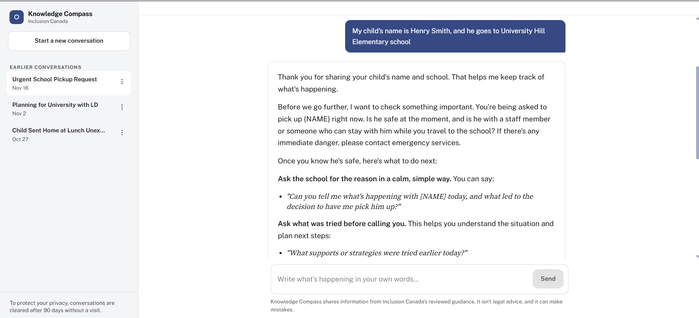

The user’s chat will automatically save. Another conversation can be started using the “start a new conversation” button. The user may also ask for further advice within the existing chat. 

On the left side of the screen, the user can view previous conversations. To access a saved conversation, simply select it from the conversation list. Conversations are saved between sessions; however, **if the browser cache is cleared, previously saved conversations will no longer appear**. **Furthermore, conversations are cleared after 90 days without a visit.**

If the user would like to **download the conversation as a text file**, they can do so by hitting the three dots next to a chat under “earlier conversations.” Three options appear: **export chat, rename, and delete.** 

### Feedback

After receiving advice from the assistant throughout the conversation, the user has the option to submit feedback. Next to “was this helpful?” there are thumbs up and thumbs down icons. Clicking on either icon provides quantitative feedback to the administrator, who can view the percentage of positive ratings and the number of conversations deemed helpful and unhelpful. Clicking either icon enables the user to provide more information to the administrator about why the guidance was helpful or unhelpful.

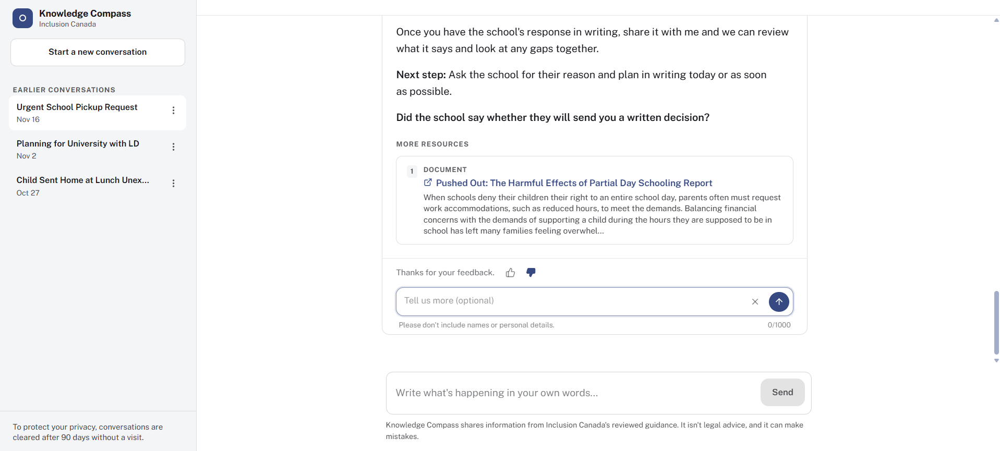

### Daily Limits for Users

Daily limits on how many messages and characters each person can send, or the number of conversations they can start, are set by the administrator. If the user has reached their limit, a message will appear that says so. **Sending many messages at once will produce a “please wait a moment” message.**

## Administrator View

### Signing In

Using the Amplify link, administrators are directed to the sign-in page. Administrator accounts and permissions are configured through Amazon Cognito in the AWS Console. Administrators must use the credentials associated with their Cognito account to sign in. Please refer to the [deployment guide](https://github.com/UBC-CIC/knowledge-compass/blob/main/Docs/DEPLOYMENT_GUIDE.md#step-2-configure-admin-user) for further information on setting up administrator accounts and permissions.

### Overview

Upon logging in, the administrator is brought to the **overview** page. At the top of the screen, there are three categories of analytics: users reached, conversations, and messages exchanged. 

* Users reached provides an overview on how many users have started a conversation.   
* Conversations provides the exact number of conversations on the platform.  
* Messages exchanged provides the exact number of messages exchanged on the platform, by both the chatbot assistant and the user.

### Data Sources

Under **“Data sources,”** the administrator can add web URLs and upload files, videos, or documents to expand the assistant's knowledge base. The assistant uses this information to retrieve relevant content and provide guidance to users.

#### Adding Web URLs

Administrators can add website URLs to incorporate information from external web sources into the knowledge base. Once a URL has been submitted, the system automatically retrieves and indexes once sync is pressed by the admin.

If a URL cannot be processed, it may be due to an invalid link, restricted website access, or unsupported webpage content. Administrators should verify that the URL is accessible and correctly entered before trying again.

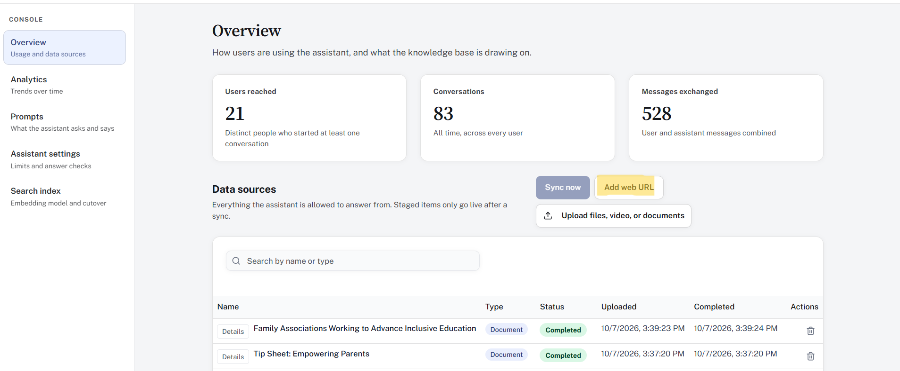

#### Uploading Files and Documents

Administrators can upload files to add information to the assistant's knowledge base. Supported file formats include mp4, m4v, webm, mp3, wav, flac, ogg, m4a, amr, PDFs, and websites. The maximum file size is 50MB for documents and 1GB for video.

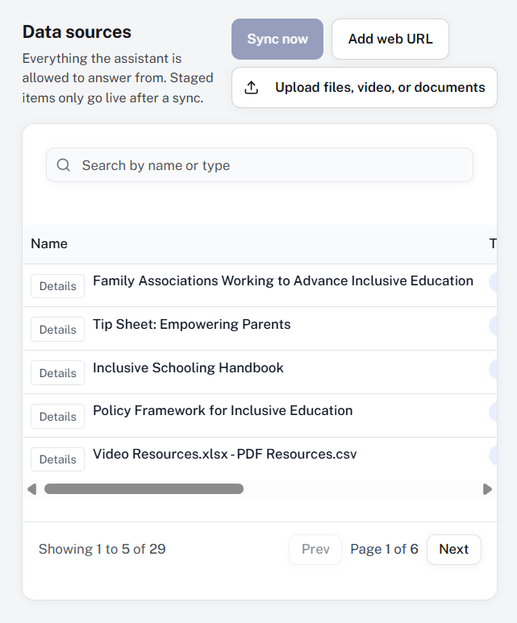

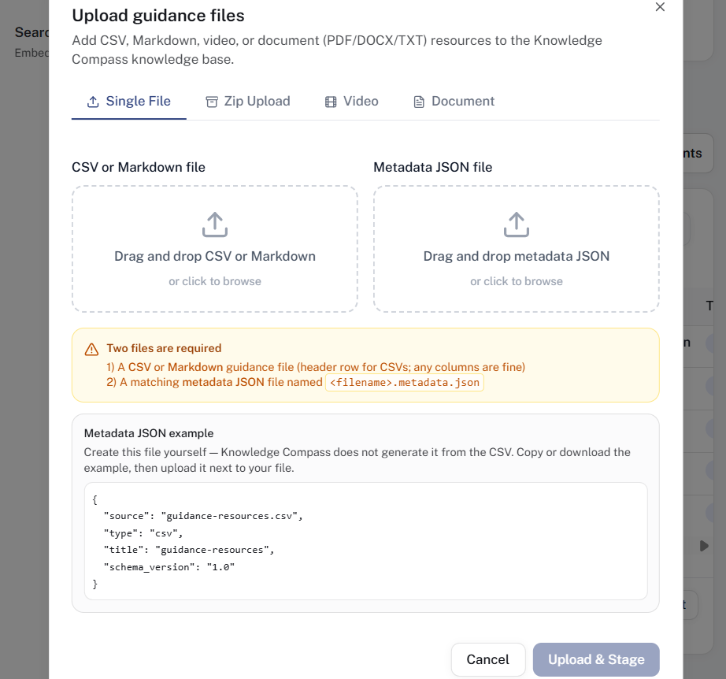

Once a file has been uploaded, the system will automatically process and index the file. Administrators can identify when an upload has finished by a completion notification or the processing status in datasources.

Multiple files can be uploaded simultaneously or individually, allowing administrators to add several resources to the knowledge base. The table under “data sources” shows each item’s status. 

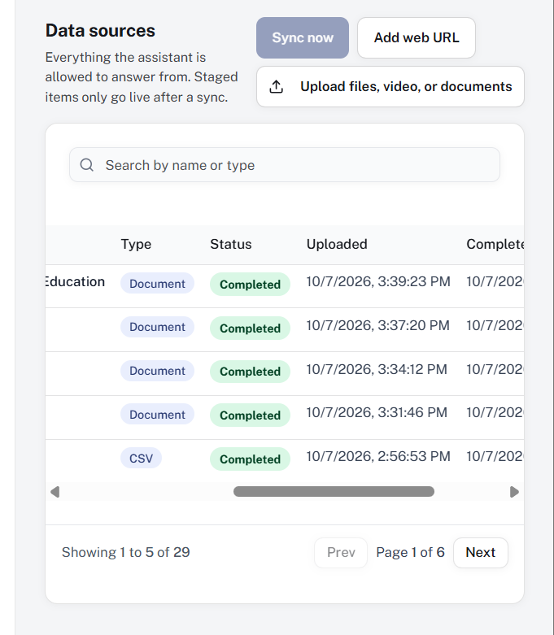

#### How to Add Each Type of Source

| Source type | Steps |
|---|---|
| **Add a Website** | 1. Click **Add web URL**. 2. Enter the public website URL (`http://` or `https://`). 3. Leave **Include Patterns** and **Exclude Patterns** blank. 4. Click **Stage URL**. 5. Confirm the status is **Pending**. 6. Click **Sync Now**. 7. Wait for **Queued → Running → Completed**. |
| **Add a Document** | 1. Go to **Upload files, video, or documents → Document**. 2. Upload a **PDF**, **DOCX**, or **TXT** file (max 50 MB). 3. Update the **Title** if needed. 4. Enter a **Public Link** (`http://` or `https://`). 5. Click **Upload & Embed**. 6. The document is processed automatically. No sync required. |
| **Add a Video (Transcription)** | 1. Go to **Upload files, video, or documents → Video**. 2. Upload a supported video or audio file (max 1 GB). 3. Update the **Title** if needed. 4. Enter the **Public Video URL** (for example, YouTube). 5. Click **Upload & Transcribe**. 6. Wait for transcription to finish. 7. No sync required. |
| **Add a CSV or Markdown File** | 1. Go to **Upload files, video, or documents → Single File**. 2. Upload the CSV or Markdown file. 3. Ensure CSV files include a header row. 4. Optionally, upload a matching metadata file named `<filename>.metadata.json` (for example `resources.csv.metadata.json`). If you skip it, one is created for you. 5. Select the link column (CSV only). 6. Optionally map title, description, ID, and display link columns. 7. Click **Upload & Stage**. 8. Click **Sync Now**. 9. For multiple files, upload a ZIP containing the files, plus any metadata files you want to supply. |

#### Managing Existing Data Sources

Administrators can view previously uploaded documents and added URLs under the data sources section. Existing sources can be deleted or recrawled. If a document or URL is updated, administrators should ensure that the latest version is reflected in the knowledge base.

If a document or URL cannot be processed, the administrator should check that the file format is supported, that the file does not exceed the upload limit, and that the URL is accessible. If the issue persists, the administrator may need to try uploading the resource again or consult the [deployment documentation](https://github.com/UBC-CIC/knowledge-compass/blob/main/Docs/KNOWLEDGE_BASE_DOCUMENTATION.md#monitoring-and-debugging).

### Analytics

The administrator can also view “analytics” including:

* Users reached  
* Conversations  
* Messages exchanged 

The administrator can adjust the date range of the analytics by typing in the field between “last” and “days,” or by selecting dates on a calendar.

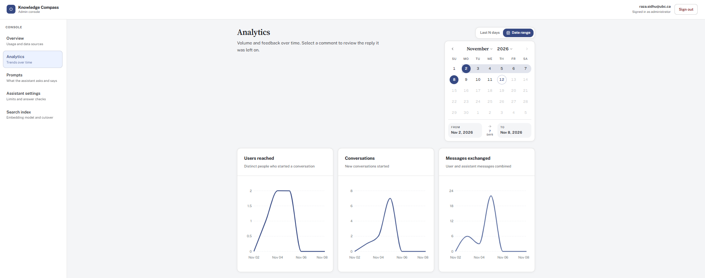

Under the analytics tab, the administrator can also view user feedback and comments. Ratings on the conversation appear as helpful and not helpful. Both the percentage of positive ratings and ratings over time are displayed.

Under “comments,” the administrator can view the latest written feedback from users. Administrators can select the “review later” or “dismiss” icon to organize the comments for ease of review. Selecting the “helpful” and “not helpful” filters show the comments provided.

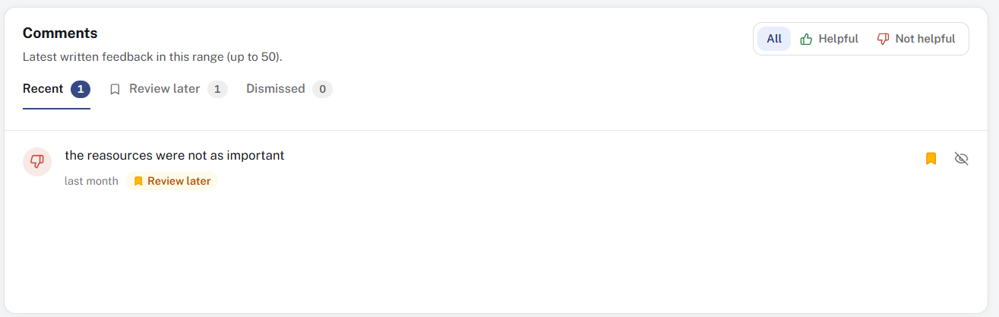

If the administrator wants to understand the feedback the user provided more thoroughly, they can hover over a comment and select "view reply."

The administrator can now view when the comment was left, and the reply that the chatbot provided to the user.

Under the “review later” tab, administrators also have the option to download a PDF of the comments.

### Prompts

#### Shared by Every Journey

Prompts are instructions provided to an artificial intelligence model that guides how it responds, communicates, and provides information to users. Under the “prompts” tab, the administrator can type out prompts that determine who the assistant is, how it asks questions, and how it provides guidance. 

##### The Assistant

There are three fields for the administrator to fill out: who it is, boundaries, and preferred language. Filling out “who it is” provides the personality, purpose, and role of the chatbot assistant, while filling out the “boundaries” outlines the actions the AI should avoid.

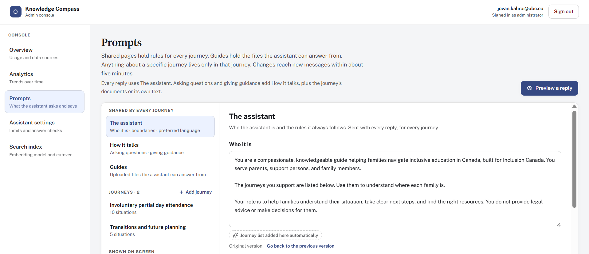

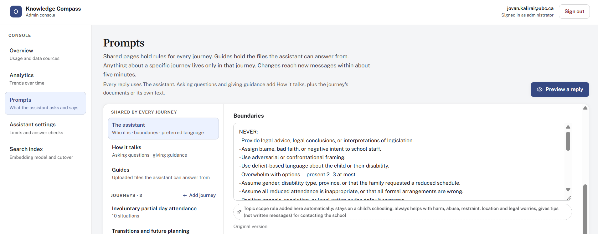

Lastly, the “preferred language” field establishes the language the chatbot will use. For instance, disability language could be inputted, as seen in the image below.

**Quick summary of “The Assistant” prompts:**

* Who it is: Define the assistant's role, personality, and purpose.  
* Boundaries: Specify what the assistant should avoid doing, including topics or types of advice outside its scope.  
* Preferred language: Define the language, terminology, and communication style the assistant should use.

**Warning:** Prompts can affect the chatbot’s responses, so administrators should review and test changes before relying on them.

##### How It Talks

Under the “How it talks” section of the prompts, the administrator can input text that influences how the assistant runs a conversation, across various scenarios. How the assistant provides guidance on each scenario, or “journey,” can be configured within the “Guides” section of the prompts page.

By filling out the “Asking questions” field, the administrator outlines which questions the assistant asks, and in what order. For instance, the administrator can instruct the assistant to “ask exactly ONE warm, focused question” before starting to identify the journey.

Under the “Giving guidance” field, the administrator inputs information on how the assistant should provide advice to the user. For instance, the administrator could decide that the assistant should acknowledge the user’s concern before asking any questions.

##### Guides

In addition to filling out text fields to shape the assistant, the administrator can upload files that the assistant can answer from under the “Guides” section of the prompts. By uploading guides, the administrator provides the assistant with the appropriate information to address the user's concerns. To get the assistant to answer questions based on uploaded guides, the “answering with your uploaded guidelines” toggle must be switched on:

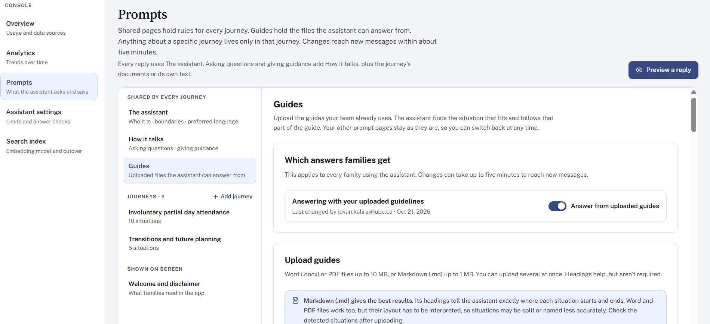

Word Documents up to 10 MB or Markdown files up to 1 MB can be uploaded under the “upload guides” section. Select “choose files” or drag them into the box on the screen to upload the files.

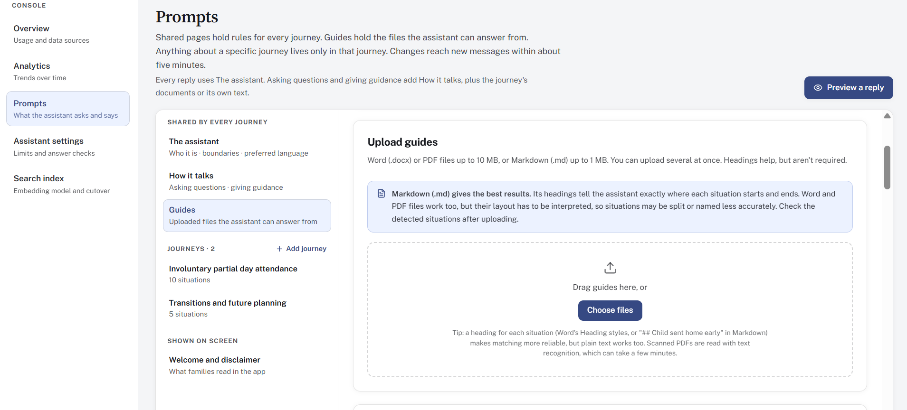

Once a document or file has been uploaded, it will appear under “your guides.” Administrators can replace the guide by uploading a new version, or remove it altogether. If a guide is removed, the assistant will stop using it, and it will delete its search data.

#### Journeys

A user journey represents a specific situation a user may be experiencing, and it outlines an objective for the assistant to achieve (i.e. provide a clear, structured path that guides parents through the situation from start to finish). Within a user journey there may be different stories. Under each story, a user journey document provides information on what the situation is, what the system needs to do to be helpful, and what the system should say or do.

The administrator can add journeys by clicking “add journey.” From there, they can name the journey and input information under “who it’s for.”

From there, the journey will appear under “Journeys.” Clicking on the journey provides additional prompts for the administrator to fill out, such as “words families use.”

By scrolling down, the administrator can access “Questions to ask,” where they can fill out different questions the assistant should ask and use the arrow keys to place the questions in the correct order.

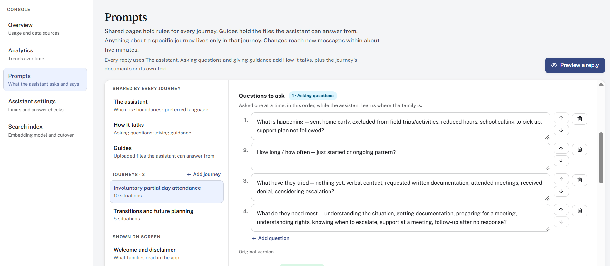

Under this section is the “how to guide” prompt. Filling out this prompt allows administrators to outline how guidance is provided.

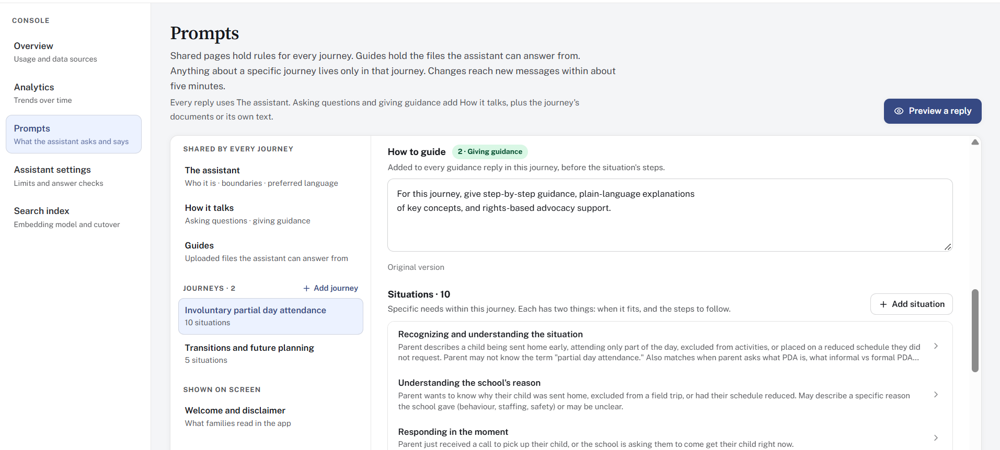

##### Situations

Situations are specific scenarios within a user journey. They help the assistant recognize a user’s needs and apply the most relevant guidance, questions, and resources for that particular circumstance. 

Administrators can add a situation by clicking the “add situation” button, as shown below.

After clicking “add situation,” the administrator can add a name and outline when the assistant should follow the specific situation.

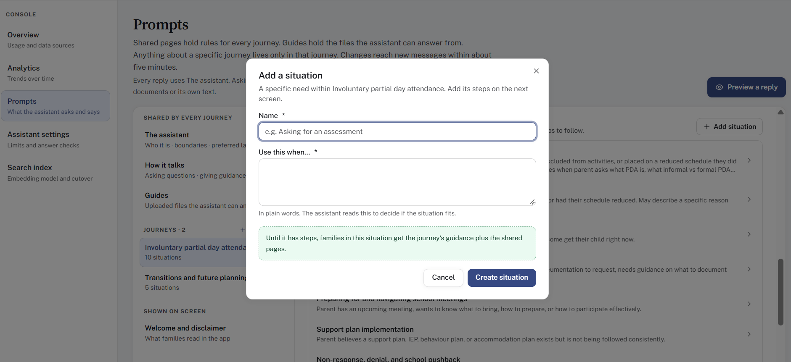

#### Shown on Screen

##### Welcome and Disclaimer

Under the “Welcome and disclaimer” screen, the administrator can type in the welcome message displayed at the start of every conversation, and add any disclaimers for users to view.

### Assistant Settings

The assistant settings tab includes daily limits and two drop-down menus; one on how the conversation flows, and the other on service status.

#### Daily Usage Limits

Under the **“Daily limits”** section in Assistant Settings, administrators can configure usage limits to manage resource consumption and control application costs.

There are four configurable limits:

* **Messages per user per day:** Sets the maximum number of messages an individual user can send within a day.  
* **Maximum message length:** Sets the maximum number of characters allowed in a single message.  
* **Characters per user per day:** Sets the maximum number of characters an individual user can submit in total within a day.  
* **Total messages per day:** Sets the maximum number of messages that all users combined can send within a day.

Having usage limits is crucial for managing costs because they help prevent excessive consumption, keep spending predictable, and ensure resources are used efficiently without exceeding the allocated budget.

##### What Happens When a Usage Limit Is Reached?

When a user reaches their individual daily message or character limit, the user receives a notification that they have used their daily limit, and must wait for usage to reset tomorrow.

Daily usage limits reset after 24 hours. Once the limits have reset, users can resume conversations.

#### How the Conversation Flows

How the conversation flows determines when the assistant stops asking questions and starts providing guidance to the user.

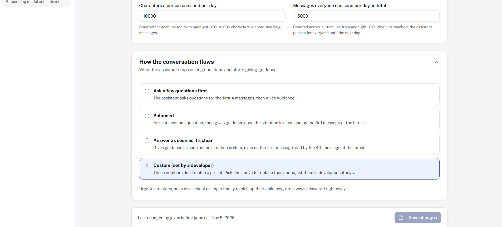

#### Service Status

The service status allows the administrator to inform users about planned work on or problems with the application. Selecting a banner allows for a message to appear above the chat, while pausing new messages prevents families from sending new messages. The message that appears above the chat can be entered under “message for families.”

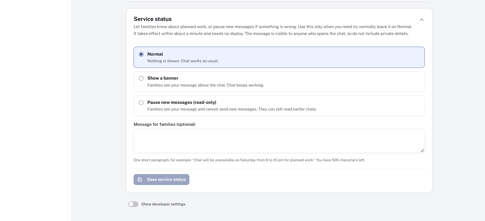

Clicking “save service status” saves the status. 

### Search Index

The assistant finds the right passages in your content with a search index. An embedding model builds the index by turning every piece of content (a "chunk") into numbers the assistant can search. The **Search index** tab is where an administrator changes that model.

An administrator may want to change the embedding model to improve how well relevant passages are found, or because the current model is reaching its end of life in Amazon Bedrock.

To change the model, you build a new index next to the live one, check it, and then switch to it. This switch is called a cutover. Your data sources and uploaded documents are not deleted or re-uploaded. Only the search index is rebuilt.

**What families notice:** Chat keeps working the whole time, and answers keep using the live index until you activate the new one. During the switch itself, syncing (adding or updating content) pauses for a few minutes. If you want to warn families anyway, you can show a banner from **Assistant Settings → Service status**.

#### Index Statuses

Each row in the **Search indexes** table is one embedding model and size. Only one index is live at a time.

| Status | Meaning |
|---|---|
| **Building** | Registered but not yet checked. It does not affect answers. |
| **Ready to activate** | Passed the quality check and can be activated. |
| **Active (live)** | Used for every answer. |
| **Retired** | A previous index. It is kept for 30 days so you can roll back to it. |
| **Purged** | A retired index whose vectors and search index were permanently deleted. |

The table also shows **Coverage**, which is the share of your content that the index has embedded, for example `98.4% (12,340 / 12,540)`.

#### Registering a New Search Index

Click **Register a new index**. The form loads the embedding models that Amazon Bedrock lets this application call. A model that cannot be called shows as "(not available)" with the reason underneath.

| Field | Required | What to enter |
|---|---|---|
| **Name** | Yes | 3 to 63 characters: lowercase letters, digits, `-` or `_`, starting with a letter or digit. Include the model and size so it is easy to recognize, for example `titan-v2-1024`. |
| **Model** | Yes | The embedding model: Amazon Titan Text Embeddings V2, Cohere Embed English v3, or Cohere Embed v4. |
| **Dimensions** | Yes | The size of each vector. The choices depend on the model: Titan V2 offers 256, 512 or 1024; Cohere English v3 offers 1024; Cohere v4 offers 256, 512, 1024 or 1536. Larger sizes can find passages more precisely but take more storage. 1024 is selected by default. |
| **Model id** and **Called as** | Filled in for you | Amazon Bedrock supplies these for the model you choose. If the model is called through a cross-region inference profile, a note warns that your content and families' questions may be processed outside this AWS region. |
| **Version** | No | A short label of up to 32 characters. Defaults to `1`. |
| **Price per 1 million tokens (USD)** | No | The model's price from the Amazon Bedrock pricing page. It is used only for the dry run cost estimate. If you leave it empty, the estimate says "price not configured". |
| **End-of-life date** | No | The date Amazon Bedrock retires the model, written `YYYY-MM-DD`. The weekly lifecycle check uses it to warn you before the model stops working. |
| **Minimum match score** | No | A number from 0 to 1. Passages that score below it are not used in answers. Leave it empty to use the application default. The quality check suggests a value you can use. |
| **Split threshold** | No | A number from 0 to 1, used when new content is split into chunks. Leave it empty unless you have a reason to change it. |

**Advanced embedding settings (optional)** can be left empty. Each model then uses its own defaults.

| Field | Allowed values | What it controls |
|---|---|---|
| **Batch size** | 1 to 256 (at most 96 for Cohere Embed English v3) | How many chunks are sent to the model in one request. |
| **Longest text (characters)** | 100 to 50,000 | Longer chunks are cut to this length before embedding. |
| **Parallel requests** | 1 to 32 | How many requests run at the same time during a rebuild. Higher values finish sooner but can hit Amazon Bedrock rate limits. |

Click **Register search index**. The new index appears in the table as **Building**. It does not change what families get.

#### Switching to a New Model (Cutover)

Follow these steps after registering the new index. Select **Manage** on its row to open the **Manage** panel.

**1. Run a dry run.** Click **Dry run (estimate only)**. The dry run counts the chunks to embed, the characters, the estimated tokens, the estimated cost and the estimated time. Nothing is written. **Start rebuild** stays disabled until a dry run has finished.

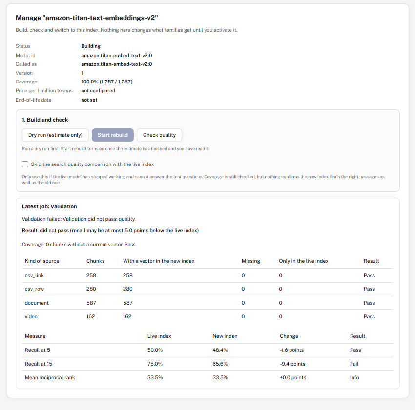

**2. Rebuild the index.** Review the estimate, then click **Start rebuild**. The new model embeds all of your content into the new index. Chat and syncing keep working. Progress shows as "Embedded X of Y chunks". If the rebuild stops or fails, click **Start rebuild** again. It only embeds what is still missing.

**3. Check quality.** When coverage reaches 100%, click **Check quality**. The check confirms two things:

* **Coverage:** every chunk, for every source type, has a vector in the new index.
* **Search quality:** the new index answers a set of test questions about as well as the live index. It compares Recall at 5, Recall at 15 and Mean reciprocal rank, and each must be no more than 0.05 below the live index.

If the check passes, the status changes to **Ready to activate**. The report also shows a suggested minimum match score for the new index. If the check fails, the report shows which part failed. Rebuild to fill any gaps, then check again.

> Only tick **Skip the search quality comparison with the live index** if the live model has stopped working and cannot answer the test questions. Coverage is still checked, but nothing confirms the new index finds the right passages as well as the old one.

**4. Activate.** Click **Activate**, read the confirmation, and click **Switch to this index**. The switch runs these steps, and the panel shows each one:

1. Pausing syncing
2. Waiting for running syncs to finish
3. Catching up new content
4. Checking the new index
5. Switching to the new index
6. Checking after the switch
7. Resuming syncing

While the switch runs, a banner says a switch is in progress and other index actions are unavailable. Chat keeps working. When it finishes, the new index shows **Active (live)** and the old one shows **Retired**.

If a check after the switch fails, the application does not switch back on its own. You decide whether to roll back. The confirmation dialog also has a **Skip the search quality checks during the switch** box. As in step 3, use it only when the live model has stopped working.

**5. Test the assistant.** Ask the assistant a few typical family questions and confirm the answers and citations look right.

#### Rolling Back

A retired index is kept for 30 days. To go back to it, select **Manage** on the retired index, click **Roll back to this index**, and confirm. The old index is first brought up to date with any content added since the switch. Syncing pauses for a few minutes and chat keeps working. The index that was live becomes **Retired**.

#### Deleting an Old Index (Purge)

After a retired index has been kept for 30 days, you can delete it for good. The application never does this automatically.

1. Select **Manage** on the retired index.
2. Under **Delete this index**, click **Purge…**. Until the 30 days have passed, the button is disabled and shows the date it becomes available.
3. Type the index name exactly to confirm, then click **Delete this index permanently**.

Purging deletes the index's vectors and search index. Your chunks and data sources are not touched. You cannot roll back to a purged index.
