# User Guide

Please ensure the application is deployed, instructions are available in the deployment guide here:  
[Click here](./DEPLOYMENT_GUIDE.md)

Once you have deployed the solution, the following user guide will help you navigate the functions available. 

| View | Description |
| :---- | :---- |
| User View | The user can start a conversation with the chatbot and ask for guidance. |
| Administrator View | The administrator can view user usage, upload and manage data sources, view analytics, manage prompts and settings for the chatbot assistant, and manage the search index. |

## Getting Started

Open the hosted Amplify URL provided during deployment, or run the frontend locally. There is no account required for the user interface, but the administrative interface requires an account. 

## User View

The user-facing interface is a chat assistant that provides users with actionable guidance that is tailored to their situation, problem, or question. 

**Home page**  
Users are immediately greeted with a welcome message and prompted to start a new conversation. The user can either type their scenario, or they can select a situation from the predefined list below the welcome message:

* My child keeps getting sent home before lunch  
* My child is being left out of field trips and activities  
* We’re getting ready for the move to high school

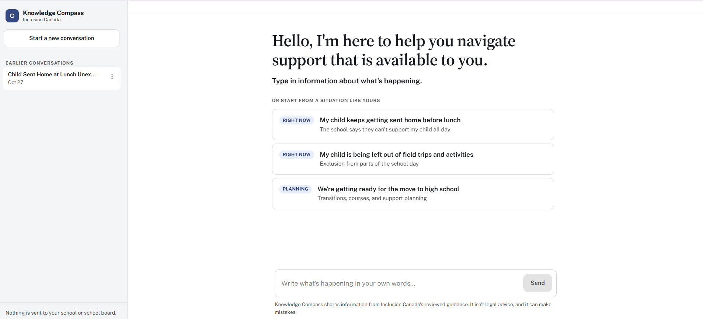

**Chat Interface**  
Once the user selects a predesignated scenario or enters a message, the chatbot will ask a series of follow-up questions to learn more about the user’s situation. When the assistant has a sufficient understanding of the situation it provides guidance: practical steps, what to ask for, and how to work with the school. 

Personal details such as names, phone numbers, email and street addresses, and health or SIN numbers are removed from the message before it is cached or sent to the AI model. If the application spots personal details, a note will appear that says your personal details will be redacted. **Inputting personal details is not required to get sound advice from the assistant.**   
****

The user’s chat will automatically save. Another conversation can be started using the “start a new conversation” button. The user may also ask for further advice within the existing chat. 

On the left side of the screen, the user can view previous conversations. To access a saved conversation, simply select it from the conversation list. Conversations are saved between sessions; however, **if the browser cache is cleared, previously saved conversations will no longer appear**. **Furthermore, conversations are cleared after 90 days without a visit.**

If the user would like to **download the conversation as a text file**, they can do so by hitting the three dots next to a chat under “earlier conversations.” Three options appear: **export chat, rename, and delete.** 

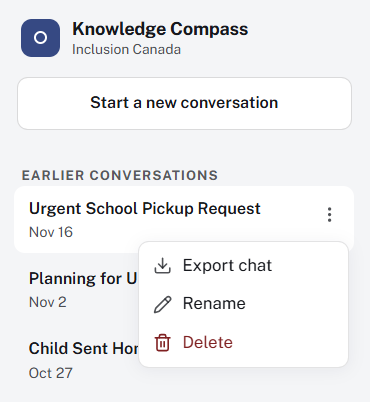

**Feedback**

After receiving advice from the assistant throughout the conversation, the user has the option to submit feedback. Next to “was this helpful?” there are thumbs up and thumbs down icons. Clicking on either icon provides quantitative feedback to the administrator, who can view the percentage of positive ratings and the number of conversations deemed helpful and unhelpful. Clicking either icon enables the user to provide more information to the administrator about why the guidance was helpful or unhelpful.  

**Additional Information**  
Daily limits on how many messages and characters each person can send, or the number of conversations they can start, are set by the administrator. If the user has reached their limit, a message will appear that says so. **Sending many messages at once will produce a “please wait a moment” message.**

## Administrator View

**Getting Started**  
Using the Amplify link, administrators are directed to the sign-in page. Administrator accounts and permissions are configured through Amazon Cognito in the AWS Console. Administrators must use the credentials associated with their Cognitio account to sign in. Please refer to the [deployment guide](https://github.com/UBC-CIC/knowledge-compass/blob/main/Docs/DEPLOYMENT_GUIDE.md#step-2-configure-admin-user) for further information on setting up administrator accounts and permissions.   
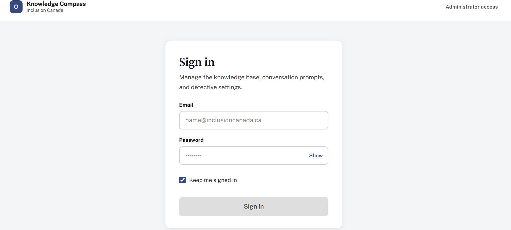  
After entering an email and password, the administrator will be prompted to set up a two-step sign in for authentication. Later sign-ins will ask for a code from the application.  

**Overview**  
Upon logging in, the administrator is brought to the **overview** page. At the top of the screen, there are three categories of analytics: users reached, conversations, and messages exchanged. 

* Users reached provides an overview on how many users have started a conversation.   
* Conversations provides the exact number of conversations on the platform.  
* Messages exchanged provides the exact number of messages exchanged on the platform, by both the chatbot assistant and the user.

### **Data Sources**

Under **“Data sources,”** the administrator can add web URLs and upload files, videos, or documents to expand the assistant's knowledge base. The assistant uses this information to retrieve relevant content and provide guidance to users.

**Adding web URLs**

Administrators can add website URLs to incorporate information from external web sources into the knowledge base. Once a URL has been submitted, the system automatically retrieves and indexes once sync is pressed by the admin.

If a URL cannot be processed, it may be due to an invalid link, restricted website access, or unsupported webpage content. Administrators should verify that the URL is accessible and correctly entered before trying again.

**Uploading files and documents**

Administrators can upload files to add information to the assistant's knowledge base. Supported file formats include mp4, m4v, webm, mp3, wav, flac, ogg, m4a, amr, PDFs, and websites. The maximum file size is 50MB for documents and 1GB for video.

Once a file has been uploaded, the system will automatically process and index the file. Administrators can identify when an upload has finished by a completion notification or the processing status in datasources.

Multiple files can be uploaded simultaneously or individually, allowing administrators to add several resources to the knowledge base. The table under “data sources” shows each item’s status. 

**Below is a table summarizing how to add different data sources:**

| Add a Website | Add a Document | Add a Video (transcription) | Add a CSV or Markdown file |
| :---- | :---- | :---- | :---- |
| Click Add web URL. Enter the site's public address. **Only public http or https addresses are accepted.** Include patterns and exclude patterns empty. They are saved but not yet applied, so the crawler reads the whole site from that address. Click Stage URL. The website appears in the table as Pending. Click Sync now. The status changes to Queued, then Running, then Completed. | Click Upload files, video, or documents and open the Document tab. Drag in or choose a PDF, Word (.docx) or text (.txt) file, up to 50 MB. Save older .doc files as .docx first. Check the Title. It is filled in from the file name; change it to what families should see, for example "Family rights handbook". Enter the Public link (required): an http or https address where families can open the document, such as its page on your website. Answers cite this link, never the uploaded file. Click Upload & embed. The text is read and added automatically; you do not need to click Sync now. | Click Upload files, video, or documents and open the Video tab. Drag in or choose the recording: video (.mp4, .m4v, .webm) or audio (.mp3, .m4a, .wav, .flac, .ogg, .amr), up to 1 GB. Upload the file itself; the app cannot download a video from YouTube. Check the Title, for example "Inclusive education webinar". Enter the Public video URL, usually the YouTube link. Answers cite this link, and video cards open it at the moment that supports the answer. Click Upload & transcribe. Amazon Transcribe creates the transcript, then the transcript is split by timestamp and added automatically. The item shows Transcribing while the transcript is made; you do not need to click Sync now. A video URL that is already used by a crawled web page or another source is rejected, so each video is added once. | Click Upload files, video, or documents and open the Single File tab. Choose the CSV or Markdown file. A CSV needs a header row. Add the matching metadata file. It must be named exactly \<file name\>.metadata.json (for example guidance-resources.csv.metadata.json). The dialog shows an example you can copy or download. For a CSV whose rows each link to a web page or PDF, choose the link column. Optionally choose the columns for a stable row id, title, description and the link families should see. The assistant then fetches each linked page and can cite individual rows. Click Upload & Stage, then Sync now. To add several files at once, put each file and its metadata file in one .zip and use the Zip Upload tab. |

**Managing existing data sources**

Administrators can view previously uploaded documents and added URLs under the data sources section. Existing sources can be deleted or recrawled. If a document or URL is updated, administrators should ensure that the latest version is reflected in the knowledge base.

If a document or URL cannot be processed, the administrator should check that the file format is supported, that the file does not exceed the upload limit, and that the URL is accessible. If the issue persists, the administrator may need to try uploading the resource again or consult the [deployment documentation](https://github.com/UBC-CIC/knowledge-compass/blob/main/Docs/KNOWLEDGE_BASE_DOCUMENTATION.md#monitoring-and-debugging).

**Analytics**   
The administrator can also view “analytics” including:

* Users reached  
* Conversations  
* Messages exchanged 

The administrator can adjust the date range of the analytics by typing in the field between “last” and “days,” or by selecting dates on a calendar.  
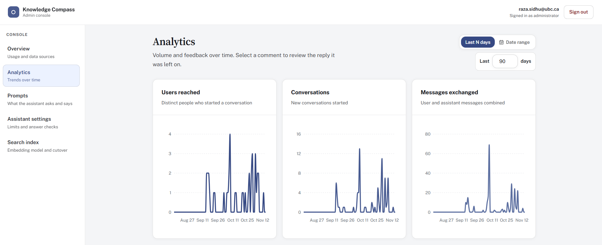  
  
Under the analytics tab, the administrator can also view user feedback and comments. Ratings on the conversation appear as helpful and not helpful. Both the percentage of positive ratings and ratings over time are displayed.   
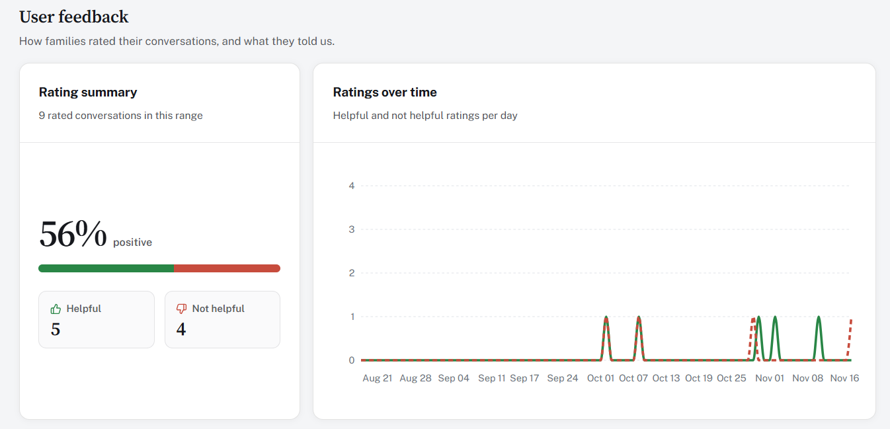  
Under “comments,” the administrator can view the latest written feedback from users. Administrators can select the “review later” or “dismiss”  icon to organize the comments for ease of review. Selecting the “helpful” and “not helpful” filters show the comments provided.  
  
Under the “review later” tab, administrators have the option to download a PDF of the comments.  
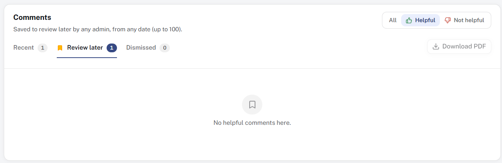

**Prompts**  
Shared by Every Journey  
Prompts are instructions provided to an artificial intelligence model that guides how it responds, communicates, and provides information to users. Under the “prompts” tab, the administrator can type out prompts that determine who the assistant is, how it asks questions, and how it provides guidance. 

*The Assistant*  
There are three fields for the administrator to fill out: who it is, boundaries, and preferred language. Filling out “who it is” provides the personality, purpose, and role of the chatbot assistant, while filling out the “boundaries” outlines the actions the AI should avoid.  
  

Lastly, the “preferred language” field establishes the language the chatbot will use. For instance, disability language could be inputted, as seen in the image below.  
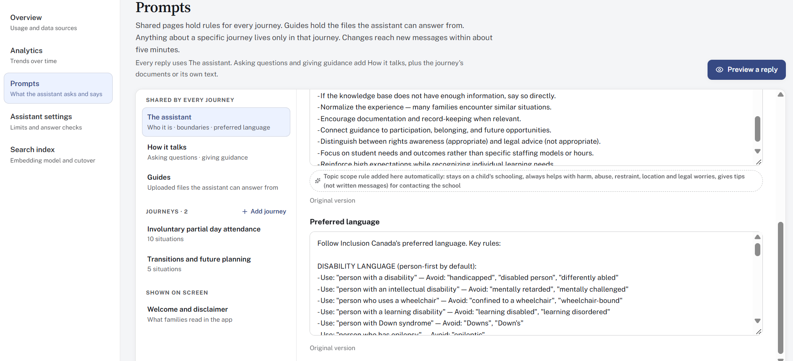

Quick Summary of “the assistant” prompts:

* Who it is: Define the assistant's role, personality, and purpose.  
* Boundaries: Specify what the assistant should avoid doing, including topics or types of advice outside its scope.  
* Preferred language: Define the language, terminology, and communication style the assistant should use.

**Warning:** Prompts can affect the chatbot’s responses, so administrators should review and test changes before relying on them.

*How it Talks*  
Under the “How it talks” section of the prompts, the administrator can input text that influences how the assistant runs a conversation, across various scenarios. How the assistant provides guidance on each scenario, or “journey,” can be configured within the “Guides” section of the prompts page.

By filling out the “Asking questions” field, the administrator outlines which questions the assistant asks, and in what order. For instance, the administrator can instruct the assistant to “ask exactly ONE warm, focused question” before starting to identify the journey.  

Under the “Giving guidance” field, the administrator inputs information on how the assistant should provide advice to the user. For instance, the administrator could decide that the assistant should acknowledge the user’s concern before asking any questions.  

*Guides*  
In addition to filling out text fields to shape the assistant, the administrator can upload files that the assistant can answer from under the “Guides” section of the prompts. By uploading guides, the administrator provides the assistant with the appropriate information to address the user's concerns. To get the assistant to answer questions based on uploaded guides, the “answering with your uploaded guidelines” toggle must be switched on:  

Word Documents up to 10 MB or Markdown files up to 1 MB can be uploaded under the “upload guides” section. Select “choose files” or drag them into the box on the screen to upload the files.  

Once a document or file has been uploaded, it will appear under “your guides.” Administrators can replace the guide by uploading a new version, or remove it altogether. If a guide is removed, the assistant will stop using it, and it will delete its search data.  
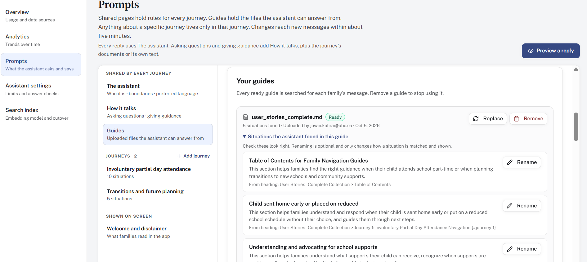

Journeys  
A user journey represents a specific situation a user may be experiencing, and it outlines an objective for the assistant to achieve (i.e. provide a clear, structured path that guides parents through the situation from start to finish). Within a user journey there may be different stories. Under each story, a user journey document provides information on what the situation is, what the system needs to do to be helpful, and what the system should say or do.

The administrator can add journeys by clicking “add journey.” From there, they can name the journey and input information under “who it’s for.”  
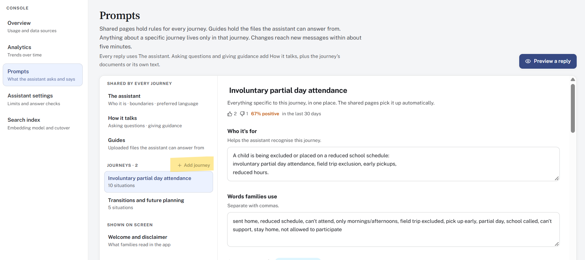  
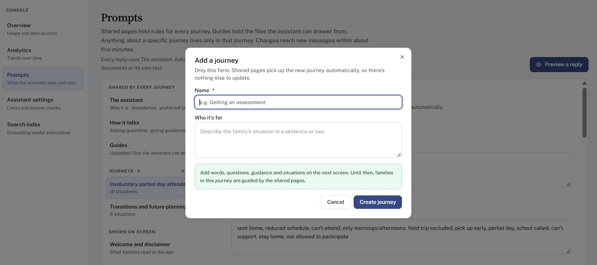

From there, the journey will appear under “Journeys.” Clicking on the journey provides additional prompts for the administrator to fill out, such as “words families use.”  

By scrolling down, the administrator can access “Questions to ask,” where they can fill out different questions the assistant should ask and use the arrow keys to place the questions in the correct order.  

Under this section is the “how to guide” prompt. Filling out this prompt allows administrators to outline how guidance is provided.  
  
Situations are specific scenarios within a user journey. They help the assistant recognize a user’s needs and apply the most relevant guidance, questions, and resources for that particular circumstance. 

Administrators can add a situation by clicking the “add situation” button, as shown below.  
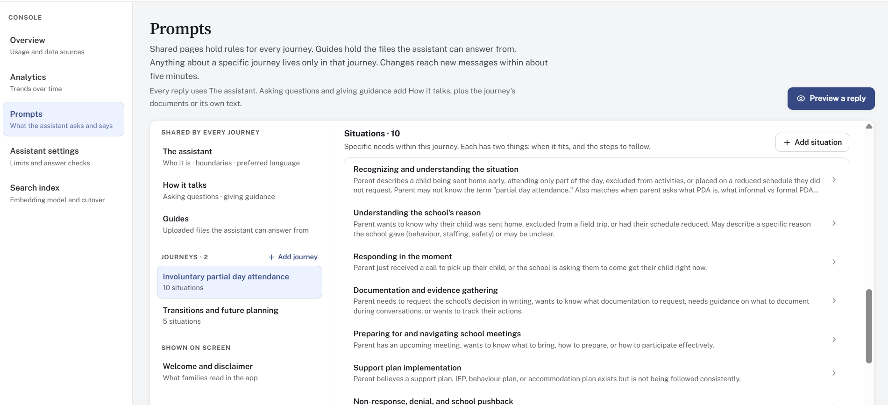  
After clicking “add situation,” the administrator can add a name and outline when the assistant should follow the specific situation.   

Shown on Screen  
*Welcome and Disclaimer*  
Under the “Welcome and disclaimer” screen, the administrator can type in the welcome message displayed at the start of every conversation, and add any disclaimers for users to view.  
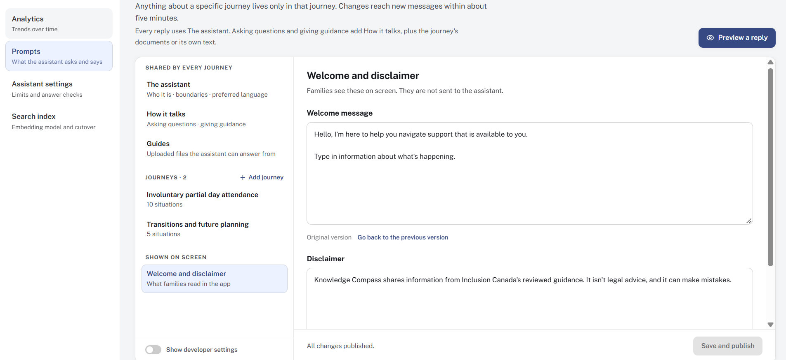

**Assistant Settings**  
The assistant settings tab includes daily limits and two drop-down menus; one on how the conversation flows, and the other on service status.

Daily Usage Limits

Under the **“Daily limits”** section in Assistant Settings, administrators can configure usage limits to manage resource consumption and control application costs.

There are four configurable limits:

* **Messages per user per day:** Sets the maximum number of messages an individual user can send within a day.  
* **Maximum message length:** Sets the maximum number of characters allowed in a single message.  
* **Characters per user per day:** Sets the maximum number of characters an individual user can submit in total within a day.  
* **Total messages per day:** Sets the maximum number of messages that all users combined can send within a day.

Having usage limits is crucial for managing costs because they help prevent excessive consumption, keep spending predictable, and ensure resources are used efficiently without exceeding the allocated budget.

**What happens when a usage limit is reached?**

When a user reaches their individual daily message or character limit, the user receives a notification that they have used their daily limit, and must wait for usage to reset tomorrow.

Daily usage limits reset after 24 hours. Once the limits have reset, users can resume conversations.

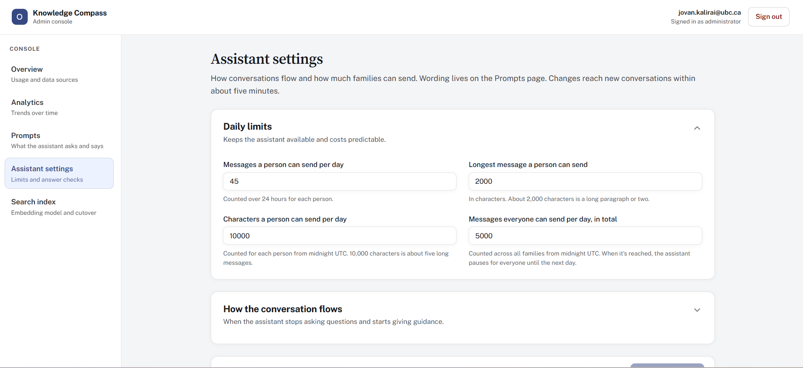

How the conversation flows determines when the assistant stops asking questions and starts providing guidance to the user.   

The service status allows the administrator to inform users about planned work on or problems with the application. Selecting a banner allows for a message to appear above the chat, while pausing new messages prevents families from sending new messages. The message that appears above the chat can be entered under “message for families.”  
  
Clicking “save service status” saves the status. 

### **Search Index**

Changing the embedding model

The Search Index tab allows administrators to change the embedding model used to organize and retrieve information from the knowledge base.

An administrator may want to change the embedding model to improve how relevant information is identified and retrieved, or to use a different model supported by the application in the event an embedding model is at the end of life.

Changing the embedding model may require the search index to be rebuilt so that existing knowledge base content is processed using the new model. During this process, the assistant's ability to retrieve information may be affected and the admin can display a notification in assistant settings to users that the system will be temporarily down during that time.

Changing the embedding model does not necessarily delete the existing knowledge base or uploaded documents. However, existing content may need to be reindexed before it can be retrieved using the new model.

The model can do a dry run to look over how many chunks need to be re indexed or the cost to re index if cost information is provided. From there it can be built to re-index the knowledge base as well as a quality comparison against the existing model.

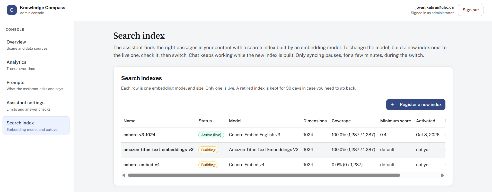

