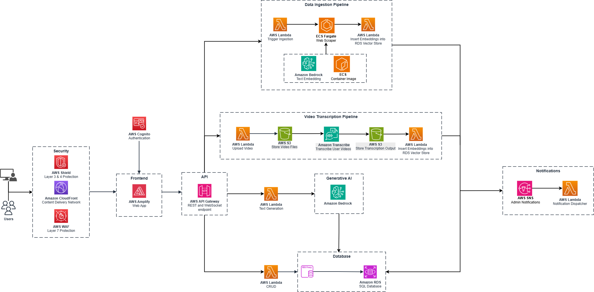

# Knowledge Compass
Knowledge Compass is a conversational assistant that uses Large Language Models (LLMs) and Retrieval-Augmented Generation (RAG) to answer questions from a curated knowledge base. The current deployment helps families find their way through Inclusion Canada's inclusive-education guidance: it asks about their situation, then suggests next steps grounded in the documents, websites and videos an administrator has added. Administrators manage the knowledge base, prompts, settings and analytics from an admin dashboard.

| Index | Description |
| :---------------------------------------------------- | :------------------------------------------------------ |
| [High Level Architecture](#high-level-architecture) | High level overview illustrating component interactions |
| [Deployment](#deployment-guide) | How to deploy the project |
| [User Guide](#user-guide) | The working solution |
| [Knowledge Base](#knowledge-base) | How content is ingested, embedded and retrieved |
| [Directories](#directories) | General project directory structure |
| [Additional Documentation](#additional-documentation) | Comprehensive guides and references |
| [Credits](#credits) | Meet the team behind the solution |
| [License](#license) | License details |

## High-Level Architecture

The following architecture diagram illustrates the various AWS components utilized to deliver the solution. For an in-depth explanation of the frontend and backend stacks, please look at the [Architecture Deep Dive](Docs/ARCHITECTURE_DEEP_DIVE.md).



## Deployment Guide

To deploy this solution, please follow the steps laid out in the [Deployment Guide](Docs/DEPLOYMENT_GUIDE.md).

## User Guide

Please refer to the [Web App User Guide](Docs/USER_GUIDE.md) for instructions on navigating the web app interface.

## Knowledge Base

Please refer to the [Knowledge Base Documentation](Docs/KNOWLEDGE_BASE_DOCUMENTATION.md). It explains how uploaded files, websites and videos are chunked, embedded and stored in pgvector, how ingestion runs and retries work, and how the admin dashboard drives them. To change the embedding model, see the [embedding model swap runbook](Docs/runbooks/embedding-model-swap.md).

## Directories

```
├── cdk/
│   ├── bin/
│   │   └── cdk.ts                    # CDK app: stack wiring and context flags
│   ├── containers/                   # ECS Fargate images built by CodePipeline
│   │   ├── common/                   # db_config, embeddings, url_safety
│   │   ├── crawler/                  # website crawler (Playwright)
│   │   ├── transcriber/              # video transcriber (Amazon Transcribe)
│   │   └── tests/
│   ├── lambda/
│   │   ├── adminAuthorizerFunction/  # Cognito admin authorizer
│   │   ├── authorization/            # user authorizer, Cognito triggers
│   │   ├── db_setup/                 # node-pg-migrate runner and migrations/
│   │   ├── ecrImageWaiter/           # waits for container images on first deploy
│   │   ├── gatewayCorsOrigin/        # copies the SPA origin into API Gateway
│   │   ├── handlers/                 # REST handlers (admin, users, sessions, ...)
│   │   ├── knowledgeBase/            # ingestion and embedding admin (Python)
│   │   ├── lifecycleCheck/           # Bedrock model lifecycle alerts
│   │   ├── textGeneration/           # chat, routing, retrieval (Python)
│   │   ├── transcribeRelay/          # forwards Transcribe and ECS task events
│   │   └── websocket/                # $connect, $default, $disconnect
│   ├── layers/
│   │   ├── shared_python/            # kc_shared: code shared by the Python Lambdas
│   │   ├── aws-jwt-verify.zip
│   │   ├── node-pg-migrate.zip
│   │   ├── postgres.zip
│   │   └── psycopg2.zip
│   ├── lib/
│   │   ├── amplify-stack.ts
│   │   ├── api-stack.ts
│   │   ├── cicd-stack.ts
│   │   ├── cost-stack.ts
│   │   ├── database-stack.ts
│   │   ├── dbFlow-stack.ts
│   │   ├── eval-stack.ts
│   │   ├── ingestion-stack.ts
│   │   ├── log-retention.ts
│   │   └── vpc-stack.ts
│   ├── test/                         # CDK contract tests (Jest)
│   └── OpenAPI_Swagger_Definition.yaml
│
├── Docs/
│   ├── media/
│   ├── runbooks/
│   ├── user-stories/
│   ├── API_DOCUMENTATION.md
│   ├── ARCHITECTURE_DEEP_DIVE.md
│   ├── AWS_MANAGED_KEYS.md
│   ├── BEDROCK_GUARDRAILS.md
│   ├── DATABASE_MIGRATIONS.md
│   ├── DEPENDENCY_MANAGEMENT.MD
│   ├── DEPLOYMENT_GUIDE.md
│   ├── EVALS.md
│   ├── KNOWLEDGE_BASE_DOCUMENTATION.md
│   ├── MODIFICATION_GUIDE.md
│   ├── PGVECTOR_MIGRATION_PLAN.md    # historical
│   ├── RETIREMENT_RUNBOOK.md         # historical
│   ├── SECURITY_OVERVIEW.md
│   └── USER_GUIDE.md
│
├── evals/                            # conversation evaluation harness
│
└── frontend/
    └── src/
        ├── assets/
        ├── components/
        │   ├── Admin/
        │   ├── ChatInterface/
        │   └── ui/
        ├── functions/
        ├── hooks/
        ├── layouts/
        ├── lib/
        ├── pages/
        │   ├── Admin/
        │   └── ChatInterface/
        ├── providers/
        ├── types/
        ├── App.tsx
        └── main.tsx
```

## Technology Stack

### Frontend

- **React 19** with TypeScript
- **Vite** for build tooling
- **Tailwind CSS** for styling
- **shadcn/ui** (Radix UI) for UI components
- **AWS Amplify** for hosting and Cognito authentication
- **Recharts** for analytics charts
- **React Router** for client-side routing

### Backend

- **AWS Lambda** (Python 3.12 and Node.js 22) for serverless compute
- **Amazon Bedrock** for LLM inference — Claude Haiku 5.5 (Anthropic)
- **Amazon Bedrock** embedding models for vector embeddings — **Amazon Titan Text Embeddings V2** on new installs (deployments created before migration 049 keep Cohere Embed English v3 until they switch); the active model is chosen from the admin console (see the [embedding model swap runbook](Docs/runbooks/embedding-model-swap.md))
- **pgvector** on PostgreSQL for vector storage and similarity search
- **PostgreSQL** (RDS) for relational data storage
- **Amazon S3** for uploaded documents and transcription outputs
- **Amazon ECS on Fargate** for the website crawler and video transcriber
- **Amazon Transcribe** and **Amazon Textract** for video transcripts and scanned PDFs
- **Amazon Bedrock Guardrails** on user input and model output
- **API Gateway** (REST and WebSocket) for APIs
- **AWS Cognito** for authentication and authorization

### Infrastructure

- **AWS CDK** (TypeScript) for infrastructure as code
- **AWS CodePipeline** for CI/CD (unit tests, container image builds and scans)
- **Amazon RDS** with RDS Proxy for managed PostgreSQL
- **Amazon VPC** for network isolation

## Additional Documentation

### Architecture and Design

- **[Architecture Deep Dive](Docs/ARCHITECTURE_DEEP_DIVE.md)**: Comprehensive overview of system architecture and component interactions
- **[Security Overview](Docs/SECURITY_OVERVIEW.md)**: Security architecture, controls, and compliance summary

### Deployment and Configuration

- **[Deployment Guide](Docs/DEPLOYMENT_GUIDE.md)**: Step-by-step instructions for deploying to AWS
- **[Modification Guide](Docs/MODIFICATION_GUIDE.md)**: Guidelines for customizing and extending the application
- **[Bedrock Guardrails](Docs/BEDROCK_GUARDRAILS.md)**: Configuration and management of AWS Bedrock guardrails for AI safety

### Development and Maintenance

- **[Database Migrations](Docs/DATABASE_MIGRATIONS.md)**: Guide to the database migration system and best practices
- **[Dependency Management](Docs/DEPENDENCY_MANAGEMENT.MD)**: Where each component's Python dependencies come from and how to change them
- **[Knowledge Base](Docs/KNOWLEDGE_BASE_DOCUMENTATION.md)**: Ingestion, embedding and retrieval
- **[Embedding Model Swap Runbook](Docs/runbooks/embedding-model-swap.md)**: Changing the embedding model with a rebuild and cutover
- **[Evaluations](Docs/EVALS.md)**: The conversation evaluation harness

### API and Usage

- **[API Documentation](Docs/API_DOCUMENTATION.md)**: Comprehensive API reference for all REST and WebSocket endpoints
- **[User Guide](Docs/USER_GUIDE.md)**: Complete guide for end-users on how to interact with Knowledge Compass

## Credits

This application was architected and developed by the UBC Cloud Innovation Centre team. Thanks to the UBC CIC Technical and Project Management teams for their guidance and support.

## License

This project is distributed under the [MIT License](LICENSE).

Licenses of third-party libraries and services used by this system:

**[PostgreSQL License](https://www.postgresql.org/about/licence/)**
For PostgreSQL — a liberal open source license, similar to BSD or MIT.

**[Cohere Terms of Use](https://cohere.com/terms-of-use)**
For Cohere Embed English v3, accessed via Amazon Bedrock for vector embeddings on deployments that still use it.

**[Anthropic Usage Policy](https://www.anthropic.com/legal/aup)**
For Claude Haiku 5.5, accessed via Amazon Bedrock for text generation.

**[MIT License](https://opensource.org/licenses/MIT)**
For open-source libraries and components used in this project.
